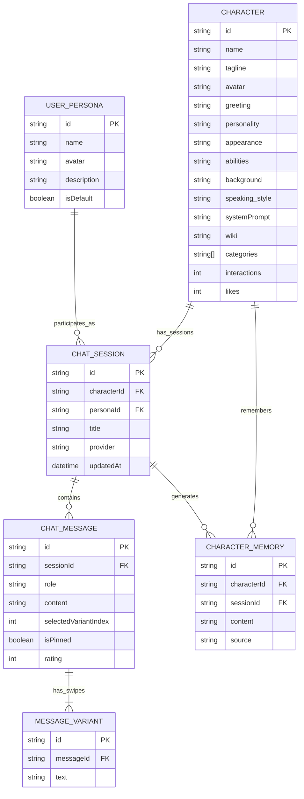
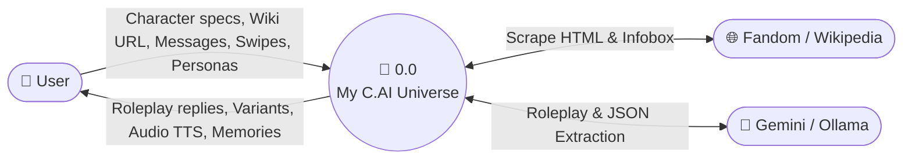

# 🌟 My C.AI Universe (v2.0)

A full-stack **Character.AI (`c.ai`)** roleplay platform built with Node.js, Express, Google Gemini / Ollama, and a modern SPA frontend. Create custom AI characters manually, auto-extract them from **Fandom / Wikipedia URLs**, or generate them from a 1-sentence concept using AI—complete with swipeable response variants, empty-Enter scene continuation, pinned memories, user personas, and long-term semantic memory.

---

## ✨ Key Character.AI Features

- **🧭 C.AI Discover & Search Feed**: Browse characters by category (*Anime, Roleplay, Fantasy, Action, Slice of Life, Mystery, Helper, Original*), search by traits, sort by popularity/likes, and jump straight into conversations.
- **✨ Character Studio (3 Ways to Create)**:
  1. **🌐 1-Click Wiki Importer**: Paste a Fandom or Wikipedia URL to automatically scrape the character's portrait, appearance, personality, abilities, backstory, speaking style, and opening greeting.
  2. **🤖 AI Concept Magic Fill**: Type a 1-line idea and let Gemini generate a complete character profile and opening roleplay scene.
  3. **✍️ Full Manual Studio**: Customize every field with a live C.AI card & greeting preview.
- **💬 Authentic C.AI Chat Experience**:
  - **Opening Character Greetings** on every new session.
  - **Light-Novel Roleplay Formatting**: `*italicized narration*`, `Character: "Quoted dialogue"`, and `**bold**` emphasis.
  - **Swipeable Response Variants (`◀ 1/3 ▶` + `🔄`)**: Generate multiple alternative replies and swipe between them.
  - **Scene Continuation (`▶▶` or Empty `Enter`)**: Let the character continue the scene naturally without user input.
  - **Rewind to Here (`⏪`) & In-Place Message Editing (`✏️`)**: Branch or refine any turn in the story.
  - **Pinned Memories (`📌`) & Long-Term Semantic Memory (`🧠`)**: Pin important turns and inspect/manage facts the character remembers about you in the right-hand drawer.
  - **Voice Read-Aloud (`🔊`)**: Built-in Web Speech API TTS to hear character dialogue spoken aloud.
  - **Live `/update field: value` Commands**: Update character attributes directly from the chat box.
- **🎭 User Personas**: Create and switch between multiple user personas so characters know who you are in the roleplay.

---

## 📁 Categorized Project Structure

```text
My C.AI Universe/
├── .github/
│   └── copilot-instructions.md      # AI coding guidelines & architecture overview
├── backend/
│   ├── ai/
│   │   ├── memory/
│   │   │   └── memoryClient.js      # Python embedding service HTTP client
│   │   ├── prompt/
│   │   │   └── characterPrompt.js   # System prompt compiler & light-novel formatter
│   │   ├── providers/
│   │   │   ├── gemini.js            # Google Gemini (@google/genai) provider & AI generator
│   │   │   ├── ollama.js            # Local Ollama provider
│   │   │   └── index.js             # Provider exports
│   │   ├── errors.js                # Custom AIError, ValidationError, NotFoundError
│   │   └── index.js                 # AI request queue & fallback orchestrator
│   ├── config/
│   │   └── index.js                 # Centralized server, AI, and DB configuration
│   ├── controllers/
│   │   ├── character.controller.js  # Character CRUD, likes, Wiki preview, AI generator
│   │   ├── chat.controller.js       # Sessions, messages, variants, continuation, rewind
│   │   ├── memory.controller.js     # Long-term character memory endpoints
│   │   └── persona.controller.js    # User persona CRUD & active default selection
│   ├── db/
│   │   ├── database.js              # Native SQLite connection & transaction manager
│   │   ├── schema.sql               # 6-table relational DDL (PKs, FKs, CASCADE, Indexes)
│   │   ├── seed.sql                 # Initial SQL INSERT seed statements
│   │   └── universe.sqlite          # Live relational SQLite database
│   ├── routes/
│   │   ├── character.route.js
│   │   ├── chat.route.js
│   │   ├── memory.route.js
│   │   ├── persona.route.js
│   │   └── index.js                 # Unified /api router
│   └── services/
│       ├── memory.service.js        # Hybrid Node.js TF-IDF + Python semantic memory engine
│       ├── storage.service.js       # Atomic JSON file repository
│       └── wiki.service.js          # Cheerio + Gemini Fandom/Wikipedia scraper
├── docs/
│   ├── ARCHITECTURE_ERD_DFD.md      # Full Architecture, ERD, and DFD (Level 0, 1, 2)
│   └── MEMORY_SERVICE.md            # Hybrid memory documentation
├── frontend/
│   ├── css/
│   │   └── styles.css               # Character.AI dark/light responsive design system
│   ├── js/
│   │   ├── api.js                   # Frontend REST API client
│   │   ├── app.js                   # Main SPA router & theme controller
│   │   ├── characters.js            # Discover feed, My Characters & Character Studio
│   │   ├── chat.js                  # Chat room, variants, rewind, pins, TTS & drawer
│   │   └── personas.js              # User persona UI module
│   └── index.html                   # Unified C.AI application shell
├── memory-service/
│   ├── memory_service.py            # Optional Python Flask sentence-transformers service
│   └── requirements.txt             # Python dependencies
├── scripts/
│   └── setup-memory.js              # Setup script for Python memory dependencies
├── tests/
│   └── api.test.js                  # Automated end-to-end API verification suite
├── .env.example                     # Environment variable template
├── .gitignore                       # Git ignore rules
├── package.json                     # Project manifest & scripts
└── server.js                        # Express application entry point
```

---

## 🏗️ System Architecture, ERD & DFD

See the complete specification in [`docs/ARCHITECTURE_ERD_DFD.md`](docs/ARCHITECTURE_ERD_DFD.md).

### Entity-Relationship Diagram (ERD)



### Data Flow Diagram (DFD Level 0 — Context Diagram)



---

## 🚀 Quick Start

1. **Install dependencies**:
   ```bash
   npm install
   ```

2. **Configure environment variables**:
   Copy `.env.example` to `.env` and set your `GEMINI_API_KEY`:
   ```env
   PORT=3000
   AI_PROVIDER=gemini
   GEMINI_API_KEY=your_gemini_api_key_here
   GEMINI_MODEL=gemini-2.5-flash
   ```

3. **Start the server**:
   ```bash
   npm start
   ```

4. **Open in browser**:
   Navigate to `http://localhost:3000`

5. **Run automated API tests**:
   ```bash
   npm test
   ```