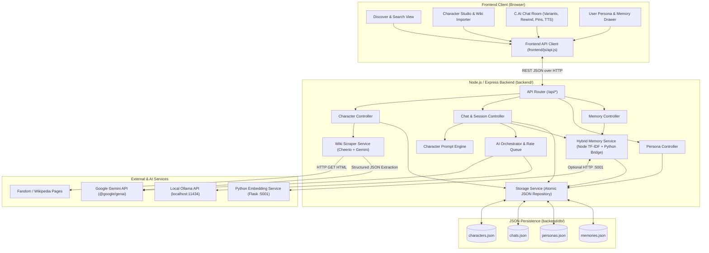
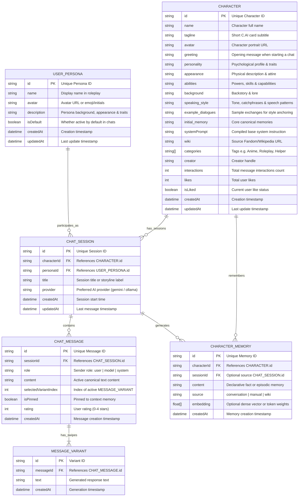
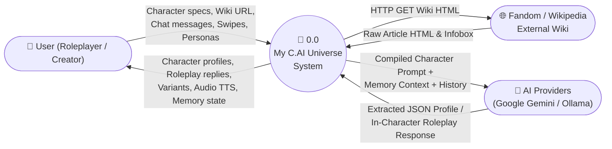
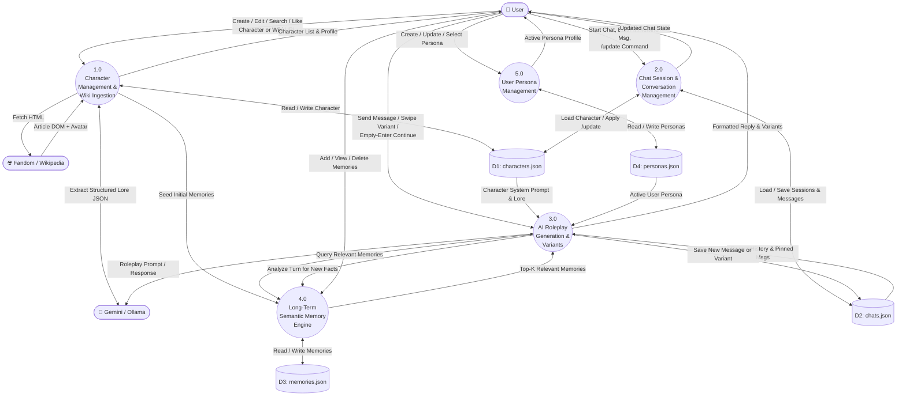
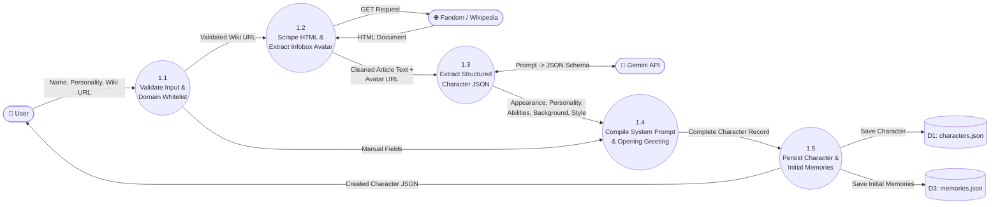
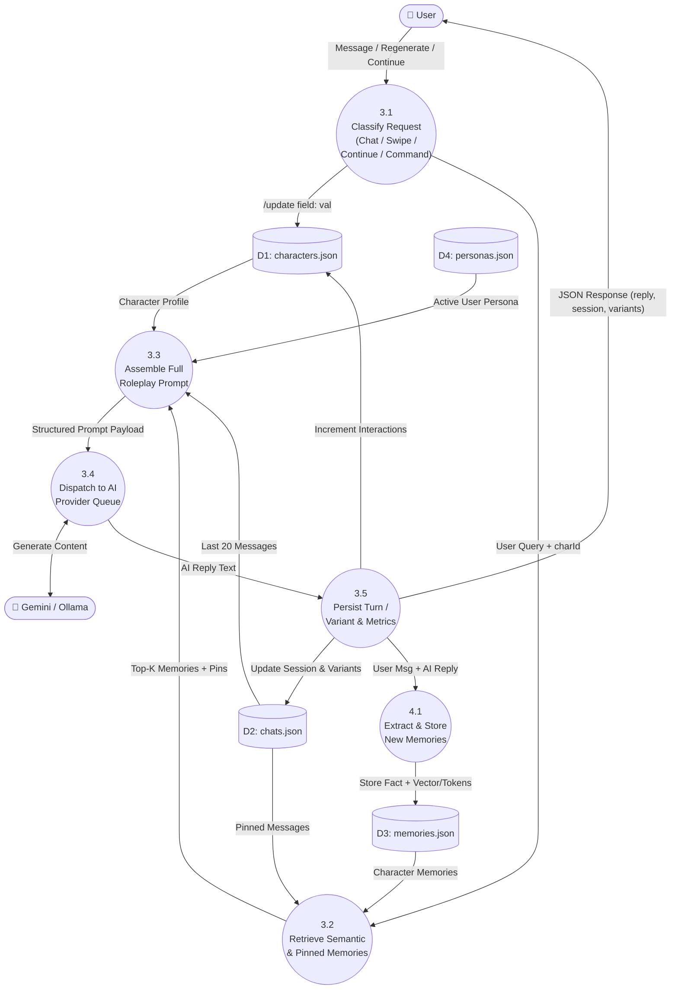

# My C.AI Universe — System Architecture, ERD & DFD Specification

This document defines the base **System Architecture**, **Entity-Relationship Diagram (ERD)**, and **Data Flow Diagrams (DFD Level 0, Level 1, and Level 2)** for **My C.AI Universe** before implementation of the backend and frontend modules.

---

## 1. System Architecture (Base Architecture)

**My C.AI Universe** follows a layered, modular client-server architecture modeled after Character.AI:

1. **Presentation Layer (`frontend/`)**:
   - Single-Page Application (SPA) shell with multi-route support (`/`, `/chat.html`, `/create.html`, `/characters.html`, `/chats.html`).
   - Built with modular Vanilla ES6 JavaScript (`api.js`, `app.js`, `chat.js`, `characters.js`, `personas.js`) and a Character.AI-inspired CSS design system (`styles.css`).
   - Features Discover feed, Character Studio (manual + Fandom/Wikipedia scraper + AI generator), Chat Room (message variants/swiping, scene continuation, message editing, rewind, pinned memories, Web Speech TTS), and User Persona management.

2. **API & Controller Layer (`backend/routes/`, `backend/controllers/`)**:
   - RESTful Express.js API handling HTTP requests, input validation, and standardized error formatting.
   - Divided into four domain controllers: `character.controller.js`, `chat.controller.js`, `persona.controller.js`, and `memory.controller.js`.

3. **Service & AI Intelligence Layer (`backend/services/`, `backend/ai/`)**:
   - **AI Orchestrator (`backend/ai/index.js`)**: Queued request dispatcher supporting Google Gemini (`@google/genai`) as primary model and local Ollama (`qwen2.5` / configurable model) as optional provider/fallback.
   - **Prompt Engine (`backend/ai/prompt/characterPrompt.js`)**: Assembles character persona, speaking style, active user persona, pinned messages, retrieved long-term semantic memories, and recent conversation history into a light-novel roleplay prompt.
   - **Wiki Scraper Service (`backend/services/wiki.service.js`)**: Fetches allowed Fandom/Wikipedia pages via Cheerio, extracts character infobox avatars and article text, and uses Gemini structured JSON extraction to populate character attributes and opening greetings.
   - **Hybrid Memory Engine (`backend/services/memory.service.js` & `memory-service/memory_service.py`)**: Combines a built-in Node.js TF-IDF/cosine similarity engine with an optional Python `sentence-transformers` microservice (`all-MiniLM-L6-v2`) for semantic memory storage and retrieval.

4. **Relational SQL Persistence Layer (`backend/db/` & `backend/services/storage.service.js`)**:
   - Powered by a normalized 6-table **SQLite Relational Database** (`backend/db/universe.sqlite`) via `node:sqlite` (`backend/db/database.js`).
   - Defined in [`backend/db/schema.sql`](../backend/db/schema.sql) and seeded via [`backend/db/seed.sql`](../backend/db/seed.sql) with Foreign Keys (`ON DELETE CASCADE`), WAL journaling, ACID transactions, and secondary indexes across `user_personas`, `characters`, `chat_sessions`, `chat_messages`, `message_variants`, and `character_memories`.

### High-Level System Architecture Diagram

---

## 2. Entity-Relationship Diagram (ERD)

The data model consists of 6 core entities:
- **`USER_PERSONA`**: Represents the user's roleplay identity (name, avatar, bio, active default flag).
- **`CHARACTER`**: Represents an AI character with rich profile attributes, greeting, wiki metadata, categories, and interaction metrics.
- **`CHAT_SESSION`**: Represents a conversation thread between a `USER_PERSONA` and a `CHARACTER`. A user can have multiple chat sessions per character (e.g., different roleplay storylines).
- **`CHAT_MESSAGE`**: Represents an individual turn (`user` or `model`) within a `CHAT_SESSION`, supporting pinning and star ratings.
- **`MESSAGE_VARIANT`**: Represents alternative generated responses (swipes) for a single `CHAT_MESSAGE`, tracking which variant index is currently selected.
- **`CHARACTER_MEMORY`**: Represents long-term episodic/factual memories associated with a `CHARACTER` (and optionally a `CHAT_SESSION`), including semantic vector/tokens and importance metadata.

---

## 3. Data Flow Diagrams (DFD)

### 3.1 DFD Level 0 — Context Diagram

The Context Diagram shows **My C.AI Universe** as a single system interacting with external entities: the **User**, **Fandom / Wikipedia**, and **AI Providers (Google Gemini / Ollama)**.

---

### 3.2 DFD Level 1 — Core System Processes

DFD Level 1 decomposes the system into **5 major processes** and **4 data stores**:

- **Process 1.0**: Character Management & Wiki Ingestion
- **Process 2.0**: Chat Session & Conversation Management
- **Process 3.0**: AI Roleplay Generation, Regeneration & Continuation
- **Process 4.0**: Long-Term Semantic Memory Management
- **Process 5.0**: User Persona Management

---

### 3.3 DFD Level 2 — Detailed Decomposition of Core Processes

#### 3.3.1 DFD Level 2: Process 1.0 (Character Creation & Wiki Extraction)

#### 3.3.2 DFD Level 2: Process 3.0 & 4.0 (Chat Turn, Memory Retrieval, Variants & Continuation)

---

## 4. REST API Contract Summary

| Method | Endpoint | Description |
| :--- | :--- | :--- |
| `GET` | `/api/health` | Server health, active AI provider, and database counts |
| `GET` | `/api/characters` | List characters (supports `?search=`, `?category=`, `?sort=`) |
| `GET` | `/api/character/:id` | Get character details by ID |
| `POST` | `/api/character` | Create character (manual or with `wiki` auto-scraping) |
| `PUT` | `/api/character/:id` | Update character profile fields and recompile system prompt |
| `DELETE` | `/api/character/:id` | Delete a character and its associated sessions/memories |
| `POST` | `/api/character/:id/like` | Toggle like on a character |
| `POST` | `/api/character/parse-wiki` | Preview extracted character data & avatar from a Wiki URL |
| `POST` | `/api/character/generate` | AI-generate character profile fields from a short concept |
| `GET` | `/api/chats` | List all chat sessions (optionally filtered by `?characterId=`) |
| `POST` | `/api/chats` | Create a new chat session with character greeting |
| `GET` | `/api/chats/:sessionId` | Get full chat session including messages and variants |
| `DELETE` | `/api/chats/:sessionId` | Delete a chat session |
| `POST` | `/api/chat` | Send message, regenerate variant (`regenerate: true`), or continue (`continue: true`) |
| `PUT` | `/api/chats/:sessionId/messages/:messageId` | Edit a message, select a variant index, pin/unpin, or rate |
| `POST` | `/api/chats/:sessionId/rewind` | Rewind conversation to a specific message ID (deletes subsequent turns) |
| `GET` | `/api/memories` | Get long-term memories (`?characterId=`) |
| `POST` | `/api/memories` | Manually add a long-term memory for a character |
| `DELETE` | `/api/memories/:id` | Delete a specific memory |
| `GET` | `/api/personas` | List user personas |
| `POST` | `/api/personas` | Create a user persona |
| `PUT` | `/api/personas/:id` | Update or set default user persona |
| `DELETE` | `/api/personas/:id` | Delete a user persona |
