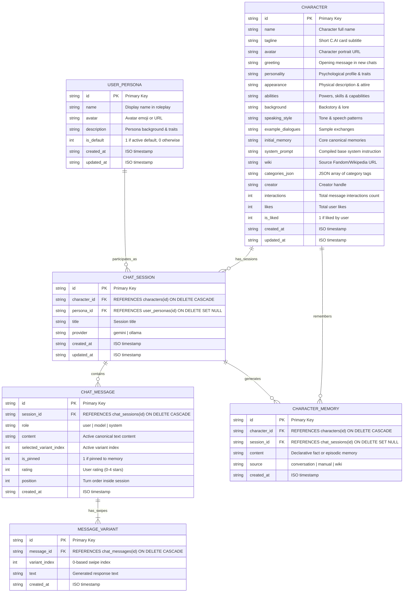
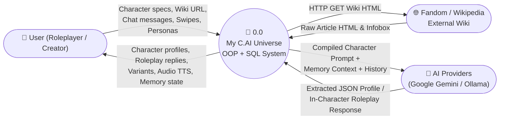
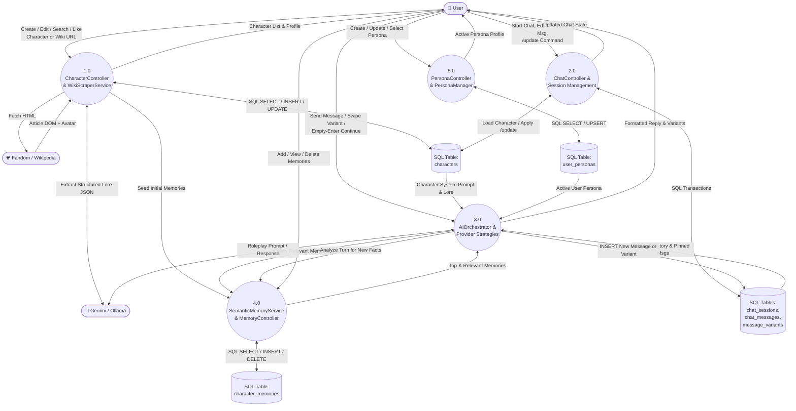

# My C.AI Universe — System Architecture, OOP Class Diagram, ERD & DFD Specification

This document defines the **Object-Oriented Programming (OOP) Architecture**, **UML Class Diagram**, **Entity-Relationship Diagram (ERD)**, and **Data Flow Diagrams (DFD Level 0, Level 1, and Level 2)** for **My C.AI Universe**.

---

## 1. Object-Oriented System Architecture

**My C.AI Universe** is built on a layered **Object-Oriented Programming (OOP)** architecture applying **Inheritance**, **Encapsulation**, **Polymorphism (Strategy Pattern)**, **Repository Pattern**, **Singleton Pattern**, and **Facade Pattern**:

1. **Domain Model Layer (`backend/models/`)**:
   - `BaseEntity` (Abstract Root Class) inherited by `Character`, `UserPersona`, `ChatSession`, `ChatMessage`, `MessageVariant`, and `CharacterMemory`.
   - Encapsulates domain validation, prompt compilation, variant swiping, message pinning, and JSON/SQL serialization.

2. **Data Access / Repository Layer (`backend/repositories/` & `backend/db/`)**:
   - `DatabaseConnection` (Singleton Class) manages the native `node:sqlite` relational database (`backend/db/universe.sqlite`), DDL schema (`backend/db/schema.sql`), and seed script (`backend/db/seed.sql`).
   - `BaseRepository` (Abstract Base Class) inherited by `CharacterRepository`, `ChatSessionRepository`, `PersonaRepository`, and `MemoryRepository`.

3. **AI Provider Strategy & Service Layer (`backend/ai/` & `backend/services/`)**:
   - `BaseAIProvider` (Abstract Strategy Class) inherited by `GeminiProvider` and `OllamaProvider`, orchestrated by `AIOrchestrator`.
   - `WikiScraperService`, `SemanticMemoryService`, and `StorageService` (Facade).

4. **Controller & HTTP Server Layer (`backend/controllers/` & `server.js`)**:
   - `BaseController` (Abstract Base Class) inherited by `CharacterController`, `ChatController`, `PersonaController`, and `MemoryController`.
   - `ApplicationServer` encapsulates Express lifecycle and middleware.

5. **Frontend OOP SPA Layer (`frontend/js/`)**:
   - `CAIUniverseApp`, `ApiClient`, `CharacterManager`, `ChatRoomController`, and `PersonaManager`.

---

## 2. UML Class Diagram (OOP Structure)

```mermaid
classDiagram
    class BaseEntity {
        <<abstract>>
        +string id
        +string createdAt
        +string updatedAt
        +generateId() string
        +touch() void
        +validate() boolean
        +toJSON() Object
    }

    class Character {
        +string name
        +string tagline
        +string avatar
        +string greeting
        +string personality
        +string appearance
        +string abilities
        +string background
        +string speaking_style
        +string systemPrompt
        +string[] categories
        +int interactions
        +int likes
        +boolean isLiked
        +recompilePrompt() void
        +toggleLike() Object
        +incrementInteractions() void
        +applyFieldUpdate(field, value) string
        +fromDatabaseRow(row)$ Character
    }

    class UserPersona {
        +string name
        +string avatar
        +string description
        +boolean isDefault
        +activate() void
        +deactivate() void
        +fromDatabaseRow(row)$ UserPersona
    }

    class ChatSession {
        +string characterId
        +string personaId
        +string title
        +string provider
        +ChatMessage[] messages
        +addMessage(msg) ChatMessage
        +getPinnedMessages() ChatMessage[]
        +rewindToMessage(id) boolean
        +fromDatabaseRow(row, msgs)$ ChatSession
    }

    class ChatMessage {
        +string sessionId
        +string role
        +string content
        +int selectedVariantIndex
        +boolean isPinned
        +int rating
        +MessageVariant[] variants
        +addVariant(text) MessageVariant
        +selectVariant(index) void
        +updateContent(text) void
    }

    class MessageVariant {
        +string messageId
        +int variantIndex
        +string text
    }

    class CharacterMemory {
        +string characterId
        +string sessionId
        +string content
        +string source
    }

    BaseEntity <|-- Character
    BaseEntity <|-- UserPersona
    BaseEntity <|-- ChatSession
    BaseEntity <|-- ChatMessage
    BaseEntity <|-- MessageVariant
    BaseEntity <|-- CharacterMemory
    ChatSession "1" *-- "many" ChatMessage : aggregates
    ChatMessage "1" *-- "1..*" MessageVariant : composes

    class BaseRepository {
        <<abstract>>
        +string tableName
        +count() int
        +deleteById(id) boolean
        +runInTransaction(fn) any
    }

    class CharacterRepository {
        +findAll() Character[]
        +findAllFiltered(params) Character[]
        +findById(id) Character
        +save(character) Character
    }

    class ChatSessionRepository {
        +findAll(characterId) ChatSession[]
        +findById(sessionId) ChatSession
        +save(session) ChatSession
    }

    class PersonaRepository {
        +findAll() UserPersona[]
        +findDefault() UserPersona
        +save(persona) UserPersona
    }

    class MemoryRepository {
        +findAll(characterId) CharacterMemory[]
        +save(memory) CharacterMemory
    }

    BaseRepository <|-- CharacterRepository
    BaseRepository <|-- ChatSessionRepository
    BaseRepository <|-- PersonaRepository
    BaseRepository <|-- MemoryRepository

    class BaseAIProvider {
        <<abstract>>
        +string providerName
        +buildSystemPrompt(char, opts) string
        +generateReply(char, msg, mem, opts)* Promise~string~
    }

    class GeminiProvider {
        +generateReply(char, msg, mem, opts) Promise~string~
        +generateCharacterProfile(concept) Promise~Object~
    }

    class OllamaProvider {
        +generateReply(char, msg, mem, opts) Promise~string~
    }

    BaseAIProvider <|-- GeminiProvider
    BaseAIProvider <|-- OllamaProvider

    class BaseController {
        <<abstract>>
        +sendJson(res, payload, code) Response
        +handleError(res, error, msg) Response
    }

    BaseController <|-- CharacterController
    BaseController <|-- ChatController
    BaseController <|-- PersonaController
    BaseController <|-- MemoryController
```

---

## 3. Entity-Relationship Diagram (ERD — Relational SQL Database)

The relational SQL schema ([`backend/db/schema.sql`](../backend/db/schema.sql) and [`backend/db/create_database.sql`](../backend/db/create_database.sql)) consists of 6 normalized tables stored in `backend/db/universe.sqlite`:

---

## 4. Data Flow Diagrams (DFD)

### 4.1 DFD Level 0 — Context Diagram

### 4.2 DFD Level 1 — Core System Processes

