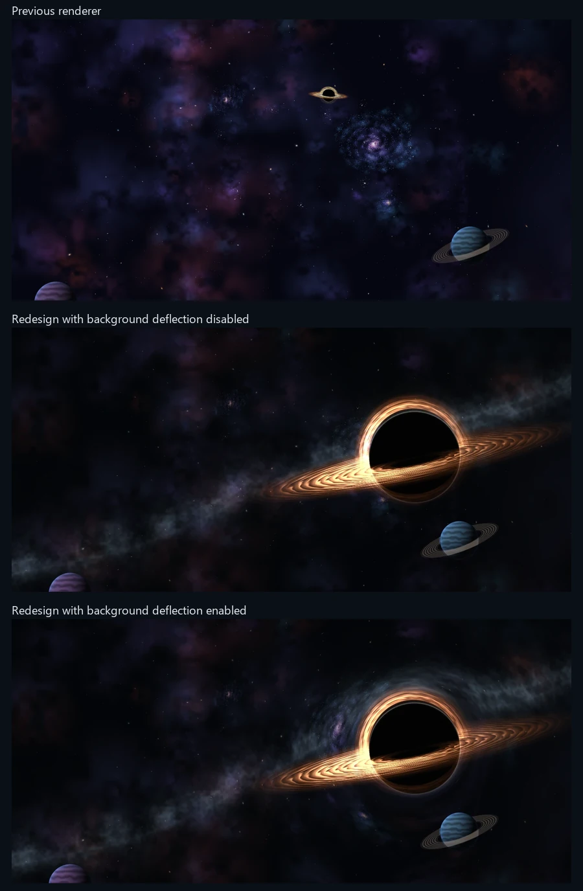

# Discover black-hole renderer review

The three frames show the previous renderer, the redesign with background deflection disabled, and the shipped effect. The dark center, bright upper arc and foreground disk are identical in the last two frames. Follow the dust lane as it approaches the shadow to see which part of the image the lens moves.

## Fixed-frame comparison

The wide and compact fallback images were captured from the shipping WebGL shader at its initial time in Microsoft Edge. Their intrinsic sizes are 1440 × 680 and 430 × 650. For the control frame, only the background lookup changed from the bent coordinate to the original coordinate.

At desktop size, 38.9% of near-field pixels differed by more than 10 levels in at least one 8-bit channel. The near field covered radii from 1.05 to 2.2 shadow radii. No far-field pixels beyond 5.3 shadow radii, or pixels in the small foreground planet control sample, exceeded that threshold. The comparison used decoded WebP captures, which introduce small compression differences.

## Render cadence

Edge 157.0.4341.60 on Windows used ANGLE Vulkan SwiftShader, with a 1024 × 524 backing canvas at DPR 1. Each run started a fresh headless profile using a localhost fixture, warmed up for 1.3 seconds and sampled 5.2 seconds of visible animation. Three alternating pairs compared commit b67d5e9 with the working renderer. Frame intervals were measured at submission of the final foreground draw. CSS page layout, hardware presentation latency and production load metrics were outside this measurement.

| Pair | Previous median / p95 | Redesign median / p95 | Interval samples, previous / redesign |
| --- | --- | --- | --- |
| 1 | 575 / 675 ms | 406 / 461 ms | 7 / 12 |
| 2 | 553 / 591 ms | 367 / 532 ms | 8 / 13 |
| 3 | 576 / 593 ms | 367 / 386 ms | 7 / 13 |

Both versions fell below their 30 fps cap on this shared machine using software rendering. The intervals describe the local capture conditions. A hardware-accelerated mobile or desktop frame-rate target still needs on-device verification.

## Browser lifecycle

- With WebGL unavailable at startup, the 1440 px poster decoded, its computed opacity was 1, and the scene made zero draw calls. Starting with reduced motion produced the same result.
- Losing the context through the WebGL test extension exposed the poster and produced zero draws during a 1.1-second observation. Restoring the context hid the poster and resumed live draws.
- Removing the scene released two buffers, two programs, one texture and one framebuffer. The removed scene made zero further draws over 1.1 seconds.
- Seventeen Node tests separately cover renderer lifecycle, responsive focal points, compositing order, backing-pixel budget and parity between both frontends, adaptive downscaling and immunity to isolated stalls.

- In a separate scroll test, Edge confirmed the scene had left the viewport before measurement. The scene made zero draws for 1.1 seconds offscreen and nine draw calls after returning to view.

## Adaptive rendering

The renderer measures visible foreground draw intervals after a 1.2-second warmup at each resolution. Eight intervals above 70 ms within ten draws lower each canvas dimension first to 75%, then to 50%. If eight intervals still exceed 100 ms at half resolution, the scene switches to its responsive poster for the rest of the mount and releases the WebGL resources. Startup, resizing, return from a hidden tab and return from offscreen start a fresh sampling window.

Two additional runs in the same software-rendered Edge fixture exercised all three resolutions.

| Run | Full-size median | 75% median | 50% median | Poster appeared |
| --- | --- | --- | --- | --- |
| 1 | 364 ms | 229 ms | 130 ms | 11.6 s |
| 2 | 466 ms | 235 ms | 128 ms | 13.4 s |

The scene occupied 1024 × 524 CSS pixels throughout. Its backing canvas stepped to 768 × 393 and 512 × 262. Both runs ended with a fully visible poster and zero draws in the next 1.1-second observation. While using the poster, decorative flow and pointer parallax stop. The scene retains its geometry in the layout and the action links remain separate HTML controls. Navigating away and mounting Discover again reassesses rendering quality.
